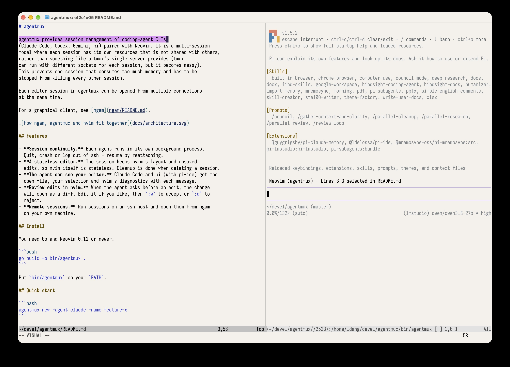
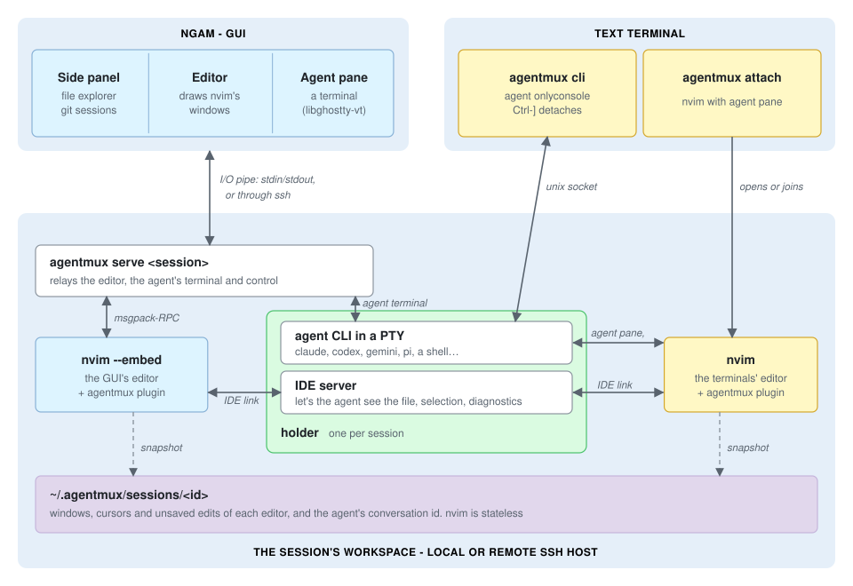

# agentmux

agentmux provides session management of coding-agent CLIs
(Claude Code, Codex, Gemini, pi) paired with Neovim. It is a multi-session
model where each session has its own resources that is not shared with others,
rather than something like a tmux's single server provides (tmux
can run with different sockets for each session, but it becomes messy).
This prevents one session that consumes too much memory and has to be
stopped from killing every other session.

Each editor session in agentmux can be opened from multiple connections
at the same time.



For a graphical client, see [ngam](ngam/README.md).



## Features

- **Session continuity.** Each agent runs in its own background process.
  Quit, crash or log out of ssh - resume by reattaching.
- **A stateless editor.** The session keeps nvim's layout and unsaved
  edits, so nvim itself is stateless. Cleanup is done when deleting a session.
- **The agent can see your editor.** Claude Code and pi (with pi-ide) get the
  open file, your selection and nvim's diagnostics with each message.
- **Review edits in nvim.** When the agent asks before an edit, the change
  will open as a diff. Edit it if you like, then `:w` to accept or `:q` to
  reject.
- **Remote sessions.** Run sessions on an ssh host and open them from ngam
  on your own machine.

## Install

You need Go and Neovim 0.11 or newer.

```bash
go build -o bin/agentmux .
```

Put `bin/agentmux` on your `PATH`.

## Quick start

```bash
agentmux new -agent claude -name feature-x
```

```bash
agentmux attach feature-x
```

## Commands

`<s>` is a session's id, a unique prefix of it, or its name. Inside a
session, it defaults to that session.

| Command | Short | What it does |
|---|---|---|
| `new [-agent A] [-name N] [-cwd DIR] [-detached]` | `n` | Create a session, and open it |
| `ls [-json]` | `l` | List sessions |
| `attach <s>` | `a` | Open the session's editor and agent in this terminal |
| `cli [-detach-key ^X\|none] <s>` | `c` | Show only the agent in this terminal. Ctrl-] leaves it running |
| `send [-s <s>] [-enter] [text…]` | `s` | Type text (or stdin) into the agent |
| `goto [<s>] file[:line[:col]]` | `g` | Show a place in the session's editor |
| `restart <s>` | `r` | Stop the agent. It resumes when you next open it |
| `delete [-force] <s>…` | `d` | Stop everything and remove the session |
| `serve [-takeover] <s>` | | Run the session for a GUI, such as ngam. `-takeover` closes a GUI editor left open by a dropped connection |

## In nvim

| Command | What it does |
|---|---|
| `:[range]AgentSend[!] [text]` | Put `@file#Lx-y text` in the agent's prompt; with `!`, send it |
| `:AgentFocus` / `:AgentEditor` | Go to the agent pane / the editor |
| `:AgentToggle` | Show or hide the agent pane |
| `:AgentRestart` | Start the agent again after it exits |
| `:AgentAccept` / `:AgentReject` | Accept or reject the agent's proposed edit (same as `:w` / `:q`) |
| `:AgentGitDiff[!] [file]` | Show a file's git changes in a diff; with `!`, the staged changes |
| `:AgentDiffDisk` | Compare a stashed buffer with the file on disk |
| `:AgentSession ls\|new\|switch <s>\|delete[!]\|detach` | Manage sessions without leaving nvim |

Map `:AgentSend` with `<Plug>(agentmux-send)`:

```lua
vim.keymap.set({ 'n', 'x' }, '<leader>as', '<Plug>(agentmux-send)')
```

## Agents

| Agent | Resumes |
|---|---|
| `claude` | yes |
| `codex` | the latest conversation in the folder |
| `gemini` | no |
| `pi` (1.4 or newer) | yes |
| `shell` | no |

To add an agent or change one, write `~/.agentmux/agents.json`:

```json
{ "aider": { "start": ["aider"] } }
```

## Settings

| Variable | What it sets |
|---|---|
| `AGENTMUX_HOME` | Where sessions are kept (default `~/.agentmux`) |
| `AGENTMUX_NVIM` | The nvim to run (default `nvim`) |

