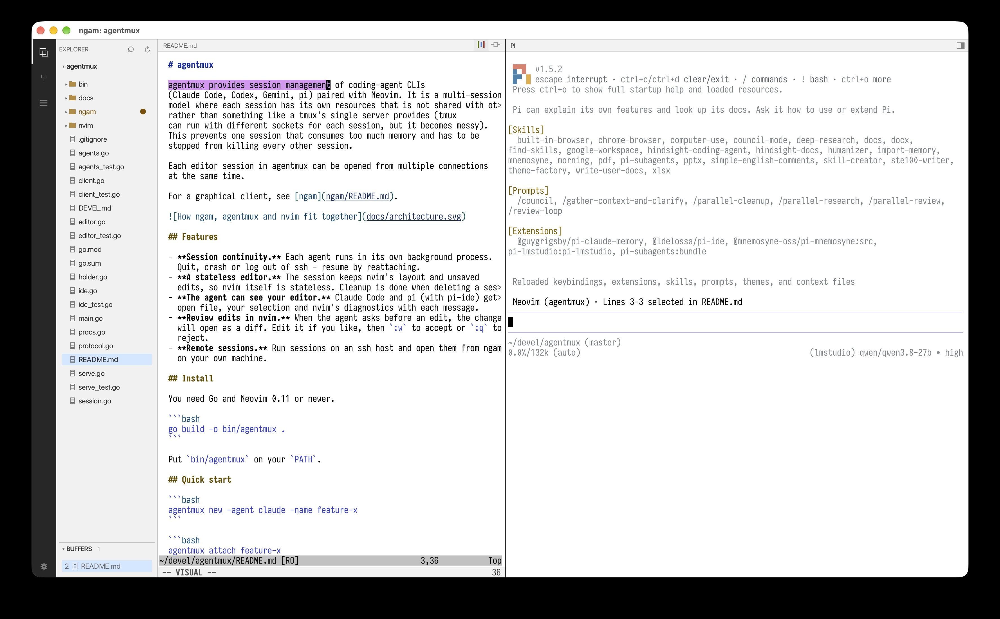
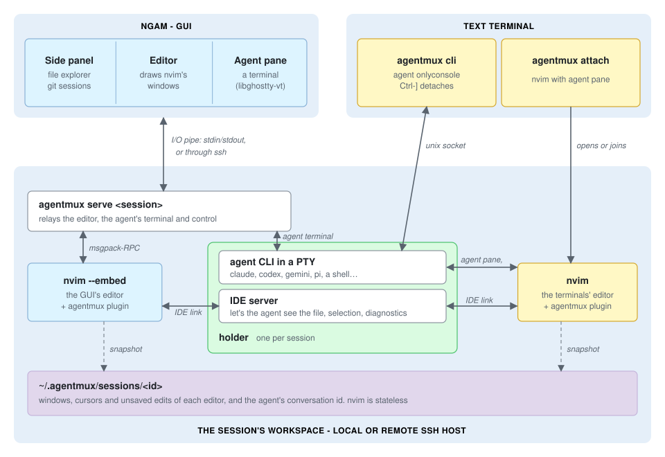

# ngam ("endgame") - neovim-graphical-agentmux IDE

ngam is a native window for [agentmux](../README.md) sessions. It provides
the same layout as agentmux with additional GUI capabilities:
file listing, git and sessions. The session can run on your machine or
on an ssh host.





## Features

- **The agent integration.** A full terminal for the agent, with colours,
  mouse support and scrollback.
- **Side panel.** File Explorer, git status, opened buffers, and session switching.
- **Git status in the editor.** blame and full commit info at each line.
- **Preview in a browser.** HTML, images, video, PDF and Markdown - reloaded live.
- **Shared sessions.** A session can be open in ngam and in a terminal at
  the same time.

## Install

You need Odin, SDL3, OpenSSL 3 and Zig (`brew install sdl3 openssl@3 zig`).
The agent pane uses Ghostty's terminal library.

### Building ghosttty

Instructions here are for macOS and assumes your workspace root is `~/src`.
They should be similar on Linux.

The agent pane needs libghostty-vt, built with Zig (`brew install zig`) from
a Ghostty checkout next to agentmux (`~/src/ghostty` here, or set
`NGAM_GHOSTTY`). ngam is tested against one Ghostty commit, kept in
[`ghostty.commit`](ghostty.commit), with Zig 0.17.1 (Ghostty's
`minimum_zig_version` is 0.17.0):

```
git clone https://github.com/ghostty-org/ghostty ~/src/ghostty
cd ~/src/ghostty
git checkout $(cat ~/src/agentmux/ngam/ghostty.commit)
zig build -Demit-lib-vt -Doptimize=ReleaseFast
```

Then, from the agentmux repo root:

```
ngam/ghostty-lib.sh        # copies the library to ngam/lib
ngam/build.sh              # checks that copy, then builds ngam/bin/ngam (with -vet)
```

`ghostty-lib.sh` takes Zig's `compiler_rt.o` out of the copy: Odin's
runtime defines some of the same helpers, and linking both fails with
duplicate symbols. `ghostty/ghostty.odin` defines the two helpers the
library still needs from it.

Both scripts check that ngam links the pinned build:

- `ghostty-lib.sh` refuses a checkout at another commit, one with local
  changes, or a library built before the commit was checked out. It
  records the copy's commit and checksum in `lib/libghostty-vt.source`.
- `build.sh` refuses a copy from another commit, or one that `zig-out` has
  replaced since (a fresh Ghostty build), and says to run `ghostty-lib.sh`
  again.

To try another Ghostty commit, set `NGAM_GHOSTTY_UNPINNED=1` for both, then
update `ghostty.commit` once it works. Extra arguments to `build.sh` go to
`odin build`; to link a library somewhere else, pass
`-define:GHOSTTY_LIB=<path relative to ngam/>` with `NGAM_GHOSTTY_UNPINNED=1`.

### Building ngam

```bash
ngam/build.sh
```

## Run

```bash
ngam/bin/ngam
```

```bash
ngam/bin/ngam <session>
```

The first command opens the setup screen to pick or create a session. The
second opens that session directly.

| Option | What it does |
|---|---|
| `-new` | Start at the setup screen to pick or create a session, instead of reopening the last windows |
| `-host H` | Open the session on ssh host `H` (`local` for this machine) |
| `-font PATH` | Use this `.ttf` or `.ttc` font |
| `-size N` | Use this font size, in points |
| `-option-as-meta` | On macOS, make Option+key send Meta |
| `-window x,y,w,h[,max]` | Place and size the window, in points; `,max` maximizes it |
| `-serve "CMD"` | Use this command to serve the session |

Closing the window leaves the agent running. If an ssh connection drops or
hangs, choose **Reconnect** in the ngam menu (or on the setup screen) to
open the session again.

## Keyboard shortcuts

On Linux, use Ctrl for Cmd. Where the two differ, the Linux key is in
brackets.

| Shortcut | What it does |
|---|---|
| Cmd-P [Ctrl-Shift-P] | Quick open |
| Cmd-B [Ctrl-Shift-B] | Show or hide the side panel |
| Cmd-Shift-E | Explorer |
| Cmd-Shift-G | Git |
| Cmd-Shift-S | Sessions |
| Cmd-Shift-A | Move the keyboard between the editor and the agent |
| Cmd-, | Settings |
| Cmd-= / Cmd-- / Cmd-0 | Font bigger / smaller / 13 pt |
| Cmd-C / Cmd-V [Ctrl-Shift-C / V] | Copy / paste |
| Click / double-click a file | Peek at it read-only (the next click replaces it) / keep it open |
| Cmd-click | Preview a file in the browser |

In the agent pane, hold Shift to select text or scroll when the agent uses
the mouse. Other Cmd keys go to nvim as `<D-x>`, so you can map them in
your config.

## Settings

Open Settings with Cmd-, or the gear at the bottom left.

| Setting | Choices |
|---|---|
| Theme | System, Light or Dark |
| Editor font | Size and font |
| Editor | Drawn by ngam or by nvim; smooth or instant scrolling |
| On start | Restore the last windows, or show the setup screen |
| Preview server | Off, HTTP or HTTPS, and its port |
| agentmux | The agentmux command, here and on ssh hosts |

## Previews over HTTPS

With HTTPS on, browsers warn until you trust ngam's certificate. To trust
it on macOS:

```bash
security add-trusted-cert -r trustRoot -k ~/Library/Keychains/login.keychain-db ~/Library/Application\ Support/ngam/preview-cert.pem
```
